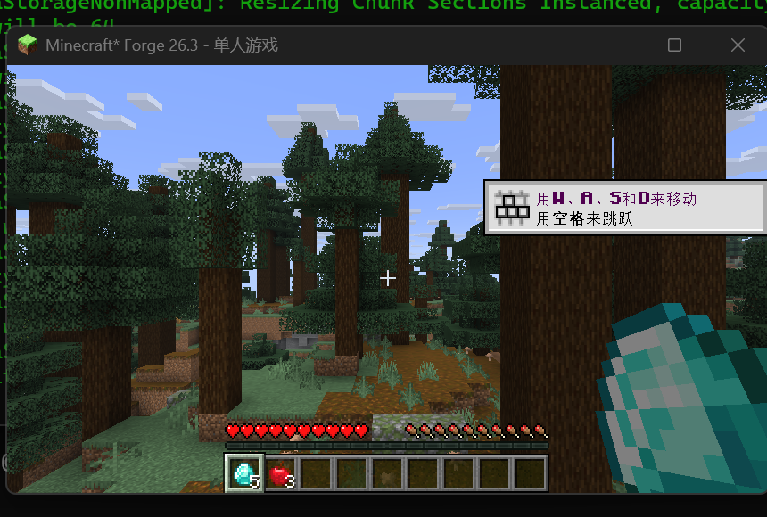

# 共享背包 (Shared Inventory)

Minecraft Forge 模组：同一个存档里，所有玩家的 **36 格主背包（快捷栏 + 背包）** 共用同一份内容。

支持版本：

下载：[GitHub Releases](https://github.com/wrj2835283280-stack/shared-inventory/releases/tag/v1.0.0)

| Minecraft | Forge | 下载 |
| --- | --- | --- |
| 26.2 | 65.1.5 | `sharedinventory-1.0.0-mc26.2.jar` |
| 26.3 | 66.1.0 | `sharedinventory-1.0.0-mc26.3.jar` |



## 功能

- 任何人捡到、用掉、合成、丢弃、移动物品，其他玩家会在 1 tick 内看到同样的变化。
- 只共享主背包 0–35 格；**盔甲、副手、末影箱、合成格不共享**。
- 玩家死亡**不掉落**共享背包里的物品，避免死亡复制。
- 共享数据保存在存档根目录：`world/sharedinventory.dat`（单人游戏在 `.minecraft/saves/<存档名>/sharedinventory.dat`）。
- 老存档第一次安装时，用第一个“背包里有物品”的玩家初始化共享背包，不会直接清空他的东西。

## PCL 安装（客户端 / 单机 / 局域网主机）

1. 在 PCL 里安装对应的 **Minecraft + Forge** 版本（26.2-65.1.5 或 26.3-66.1.0）。
2. 进入该版本 → **版本设置 → Mod 管理 → 打开 Mod 文件夹**。
3. 把对应版本的 jar 放进 `mods` 文件夹。
4. 启动游戏。单机直接生效；局域网时，**主机和其他玩家都要安装同一个 jar**。

## 服务器

1. 用对应的 Forge 版本安装服务端。
2. 把 jar 放进服务端的 `mods` 文件夹。
3. 启动服务端。客户端也必须安装同一个 jar（Forge 会校验模组列表）。

## 已验证

- **26.2-65.1.5**：两个协议客户端实测双向同步；停服重启后新玩家仍能看到钻石和苹果。
- **26.3-66.1.0**：两个协议客户端实测双向同步（A 的 5 个钻石同步给 B，B 的 3 个苹果同步给 A）；
  并实际进入 26.3 单人世界，共享存档正常读取，快捷栏显示共享的钻石和苹果。

## 从源码构建

需要 **JDK 25**。

```bat
gradlew.bat build
```

默认构建 26.2 版本。构建 26.3 版本时，需要把 `build.gradle` 的 Forge 依赖改为
`26.3-66.1.0`，并把 `mods.toml` 的 loader/forge 下限改为 `66`、Minecraft 范围改为
`[26.3,26.4)`，`pack.mcmeta` 使用格式 `121`。

## 注意

- 这是“镜像式”共享：每个人仍然有自己的背包对象，服务端每 tick 合并差异并回写。
  两个人**同一瞬间拖同一格**时，仍可能发生刷物品/吞物品；重要物品建议错开操作，并定期备份存档。
- 共享背包只有 36 格。满了以后多出来的物品会掉在操作者脚下。
- 玩家死亡掉落被取消（只针对玩家），所以死亡不会掉共享物品，也不会掉自己的盔甲/副手。
- 卸载模组后，每个玩家会保留最后一次同步到的背包内容。

## License

MIT
